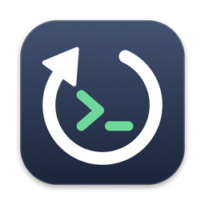
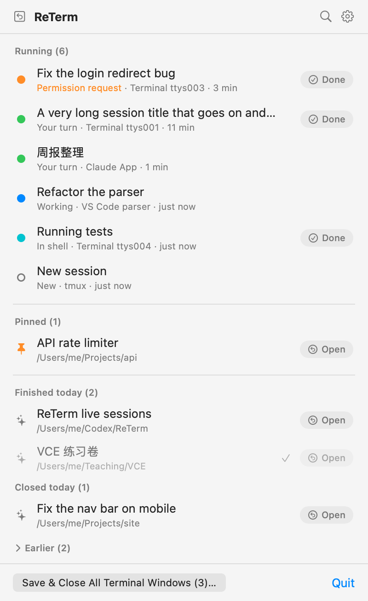

<p align="center"></p>

<h1 align="center">ReTerm</h1>

**"Reopen closed tab", for Terminal windows and Claude Code sessions.**

[](https://github.com/wangmengjames/ReTerm/releases/latest)

[](LICENSE)

English | [简体中文](README.zh-CN.md)

ReTerm is a tiny macOS menu bar app. One click closes every Terminal window and remembers them. Later, pick any one from ReTerm's panel and it comes back in the right folder, with its [Claude Code](https://claude.com/claude-code) session resumed.

While sessions are running, the same panel lists every one of them, wherever it is (Terminal, iTerm2, VS Code, the Claude app), and the menu bar icon shows how many are waiting for you.

<p align="center"></p>

## Why

If you run several Claude Code sessions at once, you end up with a wall of Terminal windows you are afraid to close, because getting one back means finding the folder, running `claude --resume` and picking the right session from a list. ReTerm turns that into one click.

## Features

- **Live sessions**: every running Claude Code session with what it is doing (*Permission request*, *Your turn*, *Working*), where it runs and for how long. Click one to bring its window to the front: the exact Terminal or iTerm2 tab, the VS Code window holding its folder, or the session in the Claude app.
- **Mark one finished**: click **Done** on a Terminal session. It is saved under **Finished today** and its window closes; reopen it from there whenever you like, with the conversation resumed. A session that is still working asks first.
- **Nothing gets lost when you just close the window**: a Claude Code session that ends on its own terms (you closed its Terminal window, quit Terminal, or restarted the Mac) is saved under **Closed today** automatically, ready to reopen with the conversation resumed. Turn it off in ⚙︎ settings with **Remember Sessions I Close Myself**.
- **A count of sessions that need you**: the number next to the menu bar icon is how many sessions are stopped on a permission prompt or a question.
- **Hide Session Titles** (in ⚙︎ settings): shows folder names instead of session titles, for screen sharing.
- **English or Chinese**: follows the system language, or pick one in ⚙︎ settings.
- **Save & Close All Terminal Windows**: records every open Terminal tab, then closes them. Warns you first if a Claude session is still working.
- **Entries you can recognise**: each one shows the session's title (the same one Claude Code puts in the window title bar) and its folder.
- **Reopen one or all**: Claude Code sessions are resumed with `claude --resume`; plain shells reopen in their folder. Reopened entries get a tick.
- **History**: the last 15 snapshots are kept under **Earlier**.
- **Save Snapshot Only**: record without closing anything.
- **Windows come back where they were**: each reopened window returns to the position and size it had when it was saved.
- **Reopen the last one from the keyboard**: `⌃⌥⌘T` anywhere brings back the most recently closed tab, like `⌘⇧T` in a browser.
- **Search & Manage** (the magnifying glass): one searchable list of everything ReTerm remembers. Reopen, pin or delete entries; pinned ones stay at the top of the panel and never age out.
- **Codex CLI sessions too**: a Terminal tab running OpenAI Codex is saved with its session and reopened with `codex resume`.
- **Built-in updates**: **Check for Updates…** installs the newest release and relaunches.
- Small and native: a few thousand lines of Swift, no dependencies, universal binary (Apple silicon and Intel).

## Install

Paste this into Terminal:

```sh
curl -fsSL https://raw.githubusercontent.com/wangmengjames/ReTerm/main/install.sh | zsh
```

It downloads the latest release into `~/Applications` and starts it. Look for the new icon in the menu bar.

<details>
<summary>Other ways to install</summary>

**Download manually.** Get `ReTerm.zip` from the [latest release](https://github.com/wangmengjames/ReTerm/releases/latest), unzip it and move `ReTerm.app` to your Applications folder. The app is not notarised by Apple, so the first launch is blocked: open System Settings › Privacy & Security and click **Open Anyway**. The install command above avoids this step.

**Build from source.** Needs the Xcode command line tools (`xcode-select --install`).

```sh
git clone https://github.com/wangmengjames/ReTerm.git
cd ReTerm
./build.sh install
open ~/Applications/ReTerm.app
```

</details>

The first time you use **Save & Close**, macOS asks whether ReTerm may control Terminal. Allow it. It is only used to find, switch to, close and reposition Terminal windows.

## How it works

- Running sessions are read from `~/.claude/sessions/<pid>.json` (only the session's id, folder, name, status and where it was started from; ReTerm never reads the tokens stored beside them). A file counts only while its process is still the one that wrote it, checked by process start time. The window a session lives in is found by walking up its parent processes to the app.
- Open tabs are found from the process table: every `login` process started by Terminal.app is one tab.
- If a Claude Code process is running in a tab, its folder and session id are read from `~/.claude/sessions/<pid>.json`, and its title from the session transcript. Otherwise the folder of the innermost process in the tab is used.
- Closing sends `SIGHUP` to the processes in each tab (the same signal Terminal sends when you close a window), then asks Terminal to close the now-idle windows.
- Reopening writes a small `.command` script and opens it with Terminal. Claude is started through your interactive login shell, so your own aliases and `PATH` apply.

## Privacy

History is stored locally in `~/Library/Application Support/ReTerm/history.json`. The only network request ReTerm makes is to the GitHub API, at most once a day, to see whether a newer release exists.

## Limits

- Save & Close and Reopen work with Terminal.app only (not iTerm2, Ghostty or the VS Code terminal). The live session list covers Terminal, iTerm2, VS Code and its relatives (Cursor, Windsurf, VSCodium) and the Claude app; a session inside tmux is listed but cannot be jumped to. Marking a session finished works for Terminal sessions; if its tab shares a window with other tabs, the session ends but the tab stays open.
- Scrollback and running commands are not restored. A plain shell comes back as a new shell in the same folder.
- The format of `~/.claude/sessions` and of session transcripts is not a documented interface and may change between Claude Code versions.
- After an update, macOS may ask again for permission to control Terminal, because the app is not signed with a developer certificate.

## Command line

```sh
~/Applications/ReTerm.app/Contents/MacOS/ReTerm --live          # running Claude Code sessions, as the panel lists them
~/Applications/ReTerm.app/Contents/MacOS/ReTerm --jump <id>     # bring that session's window to the front
~/Applications/ReTerm.app/Contents/MacOS/ReTerm --finish <id>   # save that Terminal session under Finished and close it
~/Applications/ReTerm.app/Contents/MacOS/ReTerm --list          # tabs that would be saved now
~/Applications/ReTerm.app/Contents/MacOS/ReTerm --history       # saved snapshots
~/Applications/ReTerm.app/Contents/MacOS/ReTerm --check-update  # current and latest version
```

## Uninstall

Quit ReTerm from its panel, then delete `~/Applications/ReTerm.app` and `~/Library/Application Support/ReTerm`.

## License

MIT
