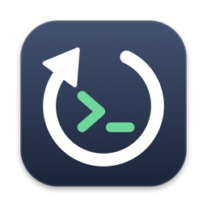
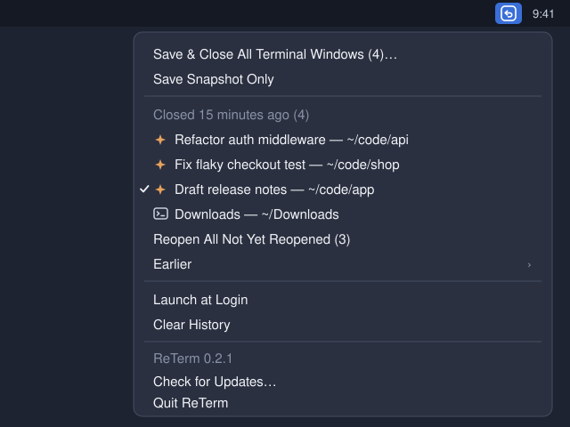

<p align="center"></p>

<h1 align="center">ReTerm</h1>

**给 Terminal 窗口和 Claude Code 会话用的"重新打开关闭的标签页"。**

[English](README.md) | 简体中文

ReTerm 是一个很小的 macOS 菜单栏工具。点一下，关掉所有 Terminal 窗口并记住它们；之后在菜单里点任意一条，它就在原来的文件夹里重新打开，[Claude Code](https://claude.com/claude-code) 会话也自动恢复。

会话还开着的时候，同一个菜单会列出所有正在运行的会话，不管它在哪里（Terminal、iTerm2、VS Code、Claude App），菜单栏图标旁边还会显示有几个在等你处理。

<p align="center"></p>

## 为什么做这个

同时开着好几个 Claude Code 会话时，桌面上会堆满不敢关的 Terminal 窗口：一旦关掉，想找回来就得先进对应文件夹，再运行 `claude --resume`，然后从列表里挑出正确的那个会话。ReTerm 把这些变成点一下。

## 功能

- **实时会话列表**：列出每个正在运行的 Claude Code 会话，显示它在做什么（*Permission request* 权限请求、*Your turn* 等你回复、*Working* 运行中）、在哪个 App 里、持续了多久。点一下就跳到它的窗口：精确到 Terminal 或 iTerm2 的那个标签页、打开着那个文件夹的 VS Code 窗口，或者 Claude App 里的那个会话。
- **标记为已完成**：在 **Mark as Finished** 子菜单里点一个 Terminal 会话（或者按住 ⌥ Option 点那一行），就把它存进 **Finished today** 并关掉窗口，之后随时可以从那里重新打开，对话自动恢复。如果会话还在工作，会先问你。
- **需要你处理的数量**：菜单栏图标旁边的数字，是停在权限请求或问题上、等你处理的会话数。
- **Hide Session Titles**：用文件夹名代替会话标题，适合共享屏幕时使用。
- **Save & Close All Terminal Windows**：记录所有打开的 Terminal 标签页后全部关闭。如果有 Claude 会话还在工作，会先提醒。
- **一眼能认出来的条目**：每条显示会话标题（就是 Claude Code 写在窗口标题栏上的那句话）和所在文件夹。
- **恢复单个或全部**：Claude Code 会话用 `claude --resume` 恢复；普通 shell 在原文件夹重新打开。已恢复的条目会打勾。
- **历史记录**：最近 15 次记录保存在 **Earlier** 里。
- **Save Snapshot Only**：只记录，不关闭。
- **内置更新**：**Check for Updates…** 一键安装最新版并重启。
- 小而原生：约 600 行 Swift，无第三方依赖，同时支持 Apple 芯片和 Intel。

## 安装

把下面这行粘贴到 Terminal：

```sh
curl -fsSL https://raw.githubusercontent.com/wangmengjames/ReTerm/main/install.sh | zsh
```

它会把最新版下载到 `~/Applications` 并启动。之后在菜单栏找新出现的图标。

<details>
<summary>其他安装方式</summary>

**手动下载。** 从[最新 Release](https://github.com/wangmengjames/ReTerm/releases/latest) 下载 `ReTerm.zip`，解压后把 `ReTerm.app` 拖到"应用程序"文件夹。这个 App 没有经过 Apple 公证，第一次打开会被拦截：到"系统设置 › 隐私与安全性"里点**仍要打开**。用上面的安装命令可以省掉这一步。

**从源码编译。** 需要 Xcode 命令行工具（`xcode-select --install`）。

```sh
git clone https://github.com/wangmengjames/ReTerm.git
cd ReTerm
./build.sh install
open ~/Applications/ReTerm.app
```

</details>

第一次使用 **Save & Close** 时，macOS 会询问是否允许 ReTerm 控制 Terminal，请点允许。这个权限只用来查找和关闭 Terminal 窗口。

## 隐私

记录只保存在本机的 `~/Library/Application Support/ReTerm/history.json`。ReTerm 唯一的联网行为是每天最多一次访问 GitHub API，查看有没有新版本。

## 限制

- 保存、关闭和恢复只支持系统自带的 Terminal.app（不支持 iTerm2、Ghostty、VS Code 终端）。实时会话列表支持 Terminal、iTerm2、VS Code 及同类编辑器（Cursor、Windsurf、VSCodium）和 Claude App；tmux 里的会话会列出来，但不能跳转。“标记为已完成”只支持 Terminal 里的会话；如果它的标签页和别的标签页在同一个窗口里，会话会结束，但那个标签页会留着。
- 不恢复滚动历史和正在运行的命令；普通 shell 恢复为同一文件夹里的新 shell。
- `~/.claude/sessions` 和会话记录的格式不是公开接口，可能随 Claude Code 版本变化。
- 更新后 macOS 可能会再问一次是否允许控制 Terminal，因为 App 没有用开发者证书签名。

## 卸载

在菜单里退出 ReTerm，然后删除 `~/Applications/ReTerm.app` 和 `~/Library/Application Support/ReTerm`。

## 许可

MIT
